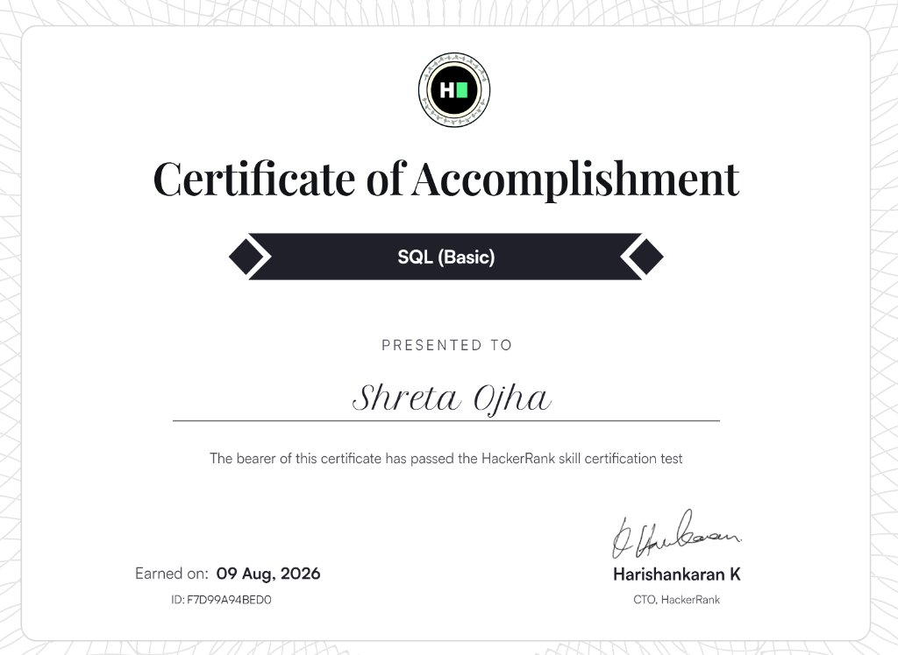
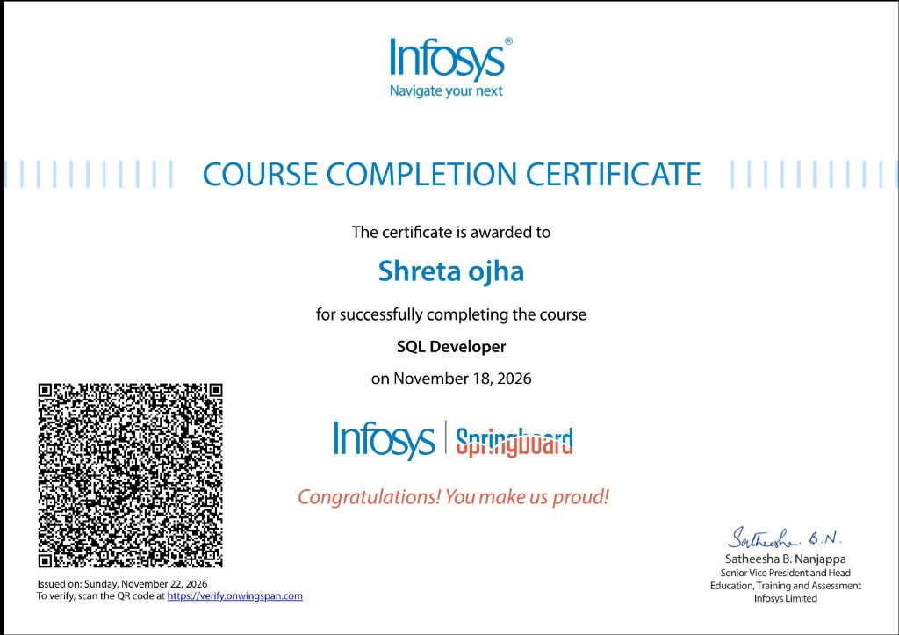

# 🎓 Database Certifications

This directory contains the professional industry certifications in **SQL and Database Management Systems** earned by **Shreta Ojha**.

---

## 📜 1. HackerRank Certificate of SQL (Basic)

- **Certification Title:** SQL (Basic) Skill Certification
- **Issuing Organization:** [HackerRank](https://www.hackerrank.com)
- **Recipient:** Shreta Ojha
- **Date of Achievement:** August 09, 2026
- **Certificate ID:** `F7D99A94BED0`
- **CTO Signature:** Harishankaran K, CTO HackerRank
- **Core Competencies Verified:**
  - Relational Database Query Formulation
  - Data Filtering, Selection & Sorting (`WHERE`, `ORDER BY`, `LIMIT`)
  - Aggregation Functions (`COUNT`, `SUM`, `AVG`, `MIN`, `MAX`, `GROUP BY`, `HAVING`)
  - Multi-Table Joins & Nested Subqueries

---

## 📜 2. Infosys Springboard SQL Developer Certificate

- **Certification Title:** SQL Developer
- **Issuing Organization:** [Infosys Springboard](https://verify.onwingspan.com) (Infosys Limited)
- **Recipient:** Shreta Ojha
- **Date of Completion:** November 18, 2026
- **Date of Issue:** November 22, 2026
- **Authorized Signatory:** Satheesha B. Nanjappa (Senior Vice President and Head, Education, Training and Assessment, Infosys Limited)
- **Online Verification:** [verify.onwingspan.com](https://verify.onwingspan.com) *(QR Code verifiable)*
- **Core Competencies Verified:**
  - Database Architecture & Relational Schema Design
  - Advanced SQL DDL, DML, and Integrity Constraints
  - Views, Common Table Expressions (CTEs), and Recursive Hierarchies
  - Stored Procedures, Functions, and Event Triggers
  - Query Optimization, Indexing Strategies, and Execution Plans

